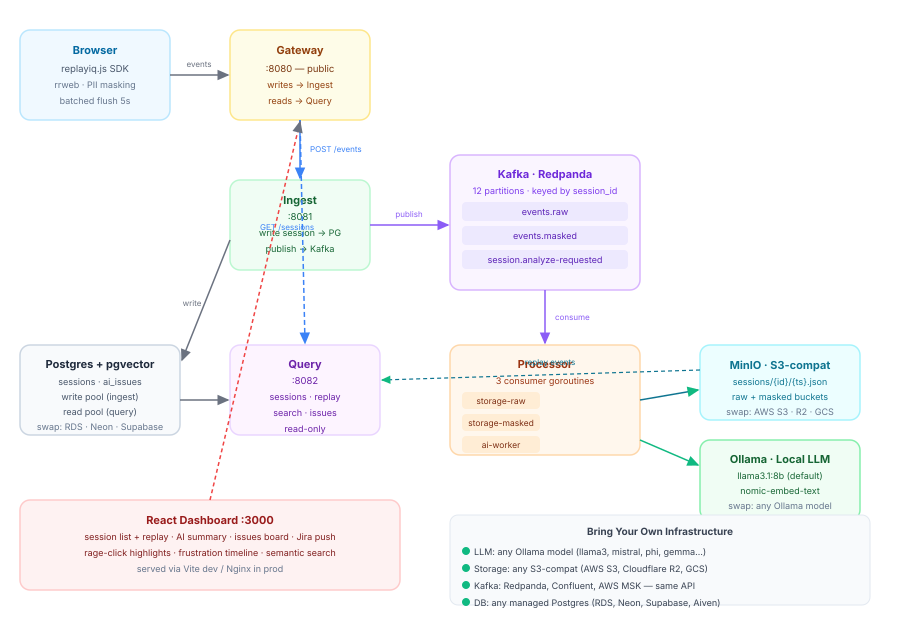

# ReplayIQ

**Self-hosted session intelligence for enterprise.** Open source, bring your own infrastructure and LLM, zero data egress.

Built on [rrweb](https://github.com/rrweb-io/rrweb) · Powered by [Ollama](https://ollama.ai) · One-command deploy

[](LICENSE)

---

## What it does

ReplayIQ gives your customer support and engineering teams full context on every user session — without sending data to a third party.

- **Session capture** — pixel-perfect rrweb recording with PII masking
- **AI summarization** — local LLM converts raw events into plain-English narratives
- **Issue detection** — rage clicks, errors, and abandonment detected and classified automatically
- **Jira integration** — one-click push from AI-detected issue to Jira ticket with full context
- **Console injection** — inject the SDK into any live site in one paste, no code deployment needed

---

## Architecture



ReplayIQ is built as four independent Go services connected by Kafka (Redpanda by default), so event ingestion is never blocked by AI analysis or storage writes.

```
Browser SDK
    │  batched flush every 5s
    ▼
Gateway :8080  ──────────────────────────── React Dashboard :3000
    │ (reverse proxy)                              │
    ├─POST /api/v1/events──▶  Ingest :8081         │
    │                              │               │
    │                    write session metadata     │
    │                       to Postgres             │
    │                              │               │
    │                   publish to Kafka topics     │
    │                    ┌─────────┴──────────┐    │
    │               events.raw   events.masked      │
    │               session.analyze-requested       │
    │                    └─────────┬──────────┘    │
    │                              ▼               │
    │                         Processor            │
    │                  ┌───────────────────┐       │
    │                  │ storage-raw    ───┼──▶ MinIO (raw)
    │                  │ storage-masked ───┼──▶ MinIO (masked)
    │                  │ ai-worker      ───┼──▶ Ollama
    │                  └───────────────────┘       │
    │                                              │
    └─GET /api/v1/sessions──▶  Query :8082 ◀───────┘
                                    │
                              Postgres (read)
                              MinIO (replay events)
```

| Service | Port | Responsibility |
|---|---|---|
| **gateway** | 8080 | Public-facing reverse proxy — routes writes to ingest, reads to query |
| **ingest** | 8081 | Receives SDK events; writes session metadata to Postgres; publishes to Kafka |
| **processor** | — | Consumes Kafka; writes event batches to MinIO; runs AI pipeline |
| **query** | 8082 | Read-only dashboard API — sessions, replay, search, issues, Jira |

All four services are compiled from the same `backend/` module and share the same Docker image via `ARG SERVICE=<name>`.

---

## Bring Your Own Infrastructure

ReplayIQ is designed to slot into your existing stack. Every component has a standard interface and can be swapped:

| Component | Default | Drop-in alternatives |
|---|---|---|
| **LLM** | Ollama + llama3.1:8b | Any model on Ollama: mistral, phi-3, gemma2, llama3.1:70b, … |
| **Object storage** | MinIO (S3-compat) | AWS S3, Cloudflare R2, Google Cloud Storage, Wasabi |
| **Message broker** | Redpanda | Apache Kafka, Confluent Cloud, AWS MSK — same API |
| **Database** | Postgres (self-hosted) | Amazon RDS, Neon, Supabase, Aiven, Google Cloud SQL |

Configure via environment variables — no code changes required. See [`.env.example`](.env.example) for all options.

---

## Quick Start

Two ways to run the stack - pick one.

### Option A — Everything in Docker

**Prerequisites:** Docker + Docker Compose, 8GB RAM minimum (16GB recommended for the 8B model), ~10GB disk for model weights.

```bash
git clone https://github.com/harshrs641/replayiq
cd replayiq
cp .env.example .env
# Edit .env with your values
docker compose up -d
```

This starts:
| Service | URL |
|---|---|
| Backend API | http://localhost:8080 |
| Dashboard | http://localhost:3000 |
| MinIO Console | http://localhost:9001 |
| Ollama | http://localhost:11434 |

Models are pulled automatically on first run (~5GB download for llama3.1:8b + nomic-embed-text).
Postgres is published on host port `5433` by default (not `5432`) to avoid clashing with a native Postgres some machines already have - override with `POSTGRES_HOST_PORT` in `.env` if yours doesn't.

### Option B — Everything natively on your machine (no Docker)

**Prerequisites:** Go, Node.js, Homebrew (macOS - used to install Postgres/MinIO/pgvector if you don't already have them), Ollama.

```bash
git clone https://github.com/harshrs641/replayiq
cd replayiq
cp .env.example .env
./dev.sh up
```

`dev.sh` provisions and runs everything as plain host processes: it installs Postgres/MinIO/pgvector via Homebrew if missing (building pgvector from source against your exact Postgres version, since Homebrew's bottle only covers the newest couple of major versions), creates the `replayiq` role/database/extension, starts MinIO and Ollama if they aren't already running, pulls the required Ollama models, then builds and runs the Go backend and the Vite dashboard dev server. Your native Postgres install is never stopped or have its other databases touched - it only gains one new role/db.

```bash
./dev.sh status   # what's running
./dev.sh logs     # tail backend + dashboard logs
./dev.sh down     # stop backend/dashboard/minio (postgres + ollama are left running)
```

### Verify

```bash
curl http://localhost:8080/health
# {"status":"ok","version":"1.0.0"}
```

---

## SDK Integration

### Option A — Console Injection (demo / no-code)

Paste this in any browser console to start recording immediately:

```javascript
(function(){function createScriptURL(url){if(window.trustedTypes){try{const policy=trustedTypes.getPolicy('replayiq')||trustedTypes.createPolicy('replayiq',{createScriptURL:input=>input});if(policy&&typeof policy.createScriptURL==='function')return policy.createScriptURL(url);}catch(e){}}return url;}var s=document.createElement('script');s.setAttribute('src',createScriptURL('http://localhost:8080/sdk/replayiq.js'));s.onload=function(){ReplayIQ.init({endpoint:'http://localhost:8080',projectId:'demo'});};document.head.appendChild(s);})()
```

### Option B — Script tag

```html
<script src="https://your-replayiq-host/sdk/replayiq.js"></script>
<script>
  ReplayIQ.init({
    endpoint: 'https://your-replayiq-host',
    key: 'your-ingest-key',     // for now: the project id
    sampleRate: 1.0,            // 0.0–1.0, default 1.0; decided once per session
    pauseWhenHiddenMs: 60000,   // pause recording in a tab hidden this long (0 = never)
    pauseWhenIdleMs: 600000,    // pause after this long with no input (0 = never)
    debug: false,
  });
</script>
```

The script loads `rrweb.min.js` from the same folder, so the page's Content Security Policy only needs to allow your ReplayIQ host.

### Option C — npm

```bash
npm install @replayiq/web
```

```javascript
import ReplayIQ from '@replayiq/web';
ReplayIQ.init({ endpoint: 'https://your-replayiq-host', key: 'your-ingest-key' });
```

The package (source in [`sdk/web`](sdk/web)) also ships the script-tag build for CDNs (`https://cdn.jsdelivr.net/npm/@replayiq/web@1/dist/replayiq.min.js`). `npm run build` there regenerates `sdk/replayiq.js`, which this server serves.

The SDK keeps its own cost on the page low:
- **Sampling is decided once per session,** before anything is downloaded. A session that isn't sampled never loads rrweb and sends nothing, and a sampled one is recorded on every page it visits.
- **rrweb loads after the page has loaded and the browser is idle.** Network, console and error capture start right away, so nothing from page startup is missed.
- **Recording pauses** when a tab has been hidden for a minute or nobody has interacted for 10 minutes. It resumes with a fresh snapshot when the user comes back.
- **Sending is reliable and small.** Batches are gzipped and retried with backoff under the same `batch_id`, so the server stores each batch once. They are also sent whenever the tab is hidden, because mobile browsers often close tabs without unloading the page.
- **Consent:** `ReplayIQ.optOut()` and `ReplayIQ.optIn()`.

### Flutter

[`sdk/flutter`](sdk/flutter) (`replayiq_flutter`): `ReplayIQ.init(key:, endpoint:)` plus `ReplayIQ.navigatorObserver` records masked screenshots, touches, taps, navigation, console, errors and HTTP calls from iOS and Android Flutter apps. See its README for setup and masking.

### How recordings reach storage

```
SDK ─▶ gateway ─▶ ingest API ─▶ Kafka events.native ─▶ transformer (processor) ─▶ events.raw / events.masked ─▶ storage
```

The ingest API only checks and accepts a batch (or answers 503 so the SDK retries). The transformer worker keeps mobile batches as sent (`sessions-native` bucket), converts screenshots and Native DOM recordings to rrweb (`internal/transform`), masks, and hands the result to the storage workers. Images and fonts that Native DOM recordings reference live in the `sessions-assets` bucket. Set `PUBLIC_API_URL` on the processor to the address dashboards use to reach the API. The all-in-one server does the same inline.

### SDKs

| Platform | Package | Records |
|---|---|---|
| Web | [`sdk/web`](sdk/web) (`@replayiq/web`) | rrweb DOM, clicks, inputs, console, network, errors |
| Flutter | [`sdk/flutter`](sdk/flutter) (`replayiq_flutter`) | Native DOM (or screenshots), touches, navigation, HTTP, errors |
| iOS (Swift) | [`sdk/ios`](sdk/ios) (`ReplayIQ`) | Native DOM from the layer tree (or screenshots), touches, URLSession, crashes |
| Android (Kotlin) | [`sdk/android`](sdk/android) (`com.replayiq:replayiq`) | Native DOM from the View tree / Compose (or screenshots), touches, OkHttp, crashes |
| React Native | [`sdk/react-native`](sdk/react-native) (`@replayiq/react-native`) | Wraps the iOS and Android SDKs, plus JS errors, console and React Navigation screens |

### Building an SDK for another platform

Every SDK (web, Flutter, iOS, Android, React Native) talks to the same [Recording API v1](docs/sdk/recording-api-v1.md). It covers authentication, gzip, batching, retries, mobile screenshots and touches, and the shared app-event types. [Recording API v1.1](docs/sdk/recording-api-v1.1-native-dom.md) adds Native DOM recording for mobile, where the UI is sent as a tree of nodes and changes instead of screenshots, plus mobile-only signals.

## AI Session Analysis

Sessions are analyzed automatically after they end, or on demand via the dashboard.

### What the AI produces

**Layer 1 — Summary** (~300 tokens, fits in any LLM context)
```json
{
  "narrative": "User abandoned signup at payment step after card-validation error returned twice.",
  "goal_achieved": false,
  "frustrations": ["Card validation error shown twice", "Submit button unresponsive after first error"],
  "tags": ["form_error", "abandoned", "billing"]
}
```

**Layer 2 — Tokenized Events** (~8KB, structured action log)
```json
[
  { "t": "2026-06-16T10:00:01Z", "action": "navigate", "target": "/signup" },
  { "t": "2026-06-16T10:00:45Z", "action": "input", "target": "input#email" },
  { "t": "2026-06-16T10:01:12Z", "action": "click", "target": "button#submit" },
  { "t": "2026-06-16T10:01:13Z", "action": "network_error", "target": "/api/validate-card", "value": "HTTP 422" },
  { "t": "2026-06-16T10:01:20Z", "action": "rage_click", "target": "button#submit" }
]
```

**Layer 3 — Full rrweb Stream** (~200KB, frame-accurate replay)

Available at `GET /api/v1/sessions/:id/replay` for exact DOM reconstruction (whole session in one response).

For playback, the dashboard streams it like a video instead: it loads the first 20 s, keeps 15 s loaded ahead of the playhead, and on a seek fetches only the part around the new position.

| Endpoint | Returns |
|---|---|
| `GET .../replay/manifest` | Timeline only: `start`, `end`, `keyframes` (FullSnapshot timestamps playback can start from), per-batch ranges. Reads no events. |
| `GET .../replay/events?from=&to=` | Events with `from <= timestamp < to` (to extend what is already playing). |
| `GET .../replay/events?at=&to=` | Jump: starts at the last keyframe at or before `at`, with a Meta event first so the chunk plays on its own. `from` in the response says where it starts. |
| `GET .../replay/activity` | Navigation plus SDK-tagged events (clicks, inputs, console, network) for the Behaviour/Console/Network tabs. |

All accept `masked=true|false` like `/replay` and are gzip-compressed (about 6x for DOM events). Once a session has ended, its chunks are cacheable by the browser for a day and its manifest for 5 minutes; sessions still recording are never cached.

Each stored batch carries its time range and keyframes as object metadata, so the manifest is one listing call. Batches stored before that are read once to build their index, cached in memory; run `go run ./cmd/backfill-index` (from `backend/`, with the same `MINIO_*` env) once to write the index into them for good.

**Live sessions:** while a session is still recording (no end signal yet, or ended under 2 minutes ago; a session with no events for 5 minutes stops counting), the manifest says `"live": true`. The player then opens at the newest moment and follows new events like a live stream (a **LIVE** / **GO LIVE** button under it):
- **How new events arrive:** the player keeps `GET .../replay/live?after=<ms>` open, a server-sent event stream. The server checks storage every second and pushes the new manifest together with the events stored since the last update. Each update's `id` lets a reconnecting `EventSource` resume where it left off. When the session ends, the stream says `end` and closes.
- **Markers:** errors, failed requests and rage clicks appear on a bar under the player as they arrive, and each one is clickable. rrweb-player positions its own markers only once, when it opens.

**Finished sessions** are cached in the query service: where their replay is stored for 5 minutes, and their gzipped chunk and activity responses for an hour, up to 128 MB. Re-watching one costs no storage reads or compression.

**Jump to findings:** `GET /api/v1/sessions/:id/moments` returns when each AI frustration and issue happened. The analysis prompt numbers the events and asks the model to cite the one each finding is about; findings without a usable citation, and sessions analysed before this, are placed by matching their text against the events (`source: "matched"`, shown as "≈"). How each time was found is stored with it, and older sessions are matched the first time they are viewed and saved, so matching runs once per finding. The dashboard puts a ▶ button on each finding, and the Issues tab has "Watch in replay".

**Links:** `http://<dashboard>/?session=<id>&t=<seconds>` opens a session at that moment; "Copy link at this moment" above the player makes one.

The web SDK takes a keyframe at least every 30 s of activity (`checkoutEveryNms`), so a seek never replays more than that. Mobile SDK batches are sent with `device_masked: true`: their pixels are masked on the phone, so no second, server-masked copy is stored and replays serve the single copy as "Masked on device".

### Trigger analysis manually

```bash
curl -X POST http://localhost:8080/api/v1/sessions/SESSION_ID/analyze
```

---

## Jira Integration

### Configure

```bash
# In .env
JIRA_BASE_URL=https://yourcompany.atlassian.net
JIRA_EMAIL=you@company.com
JIRA_API_TOKEN=your_token        # https://id.atlassian.com/manage-profile/security/api-tokens
JIRA_PROJECT_KEY=ENG
```

### Push AI issue to Jira

```bash
curl -X POST http://localhost:8080/api/v1/jira/issues \
  -H 'Content-Type: application/json' \
  -d '{
    "session_id": "ses_xxx",
    "issue_id": "issue_uuid",
    "summary": "Card validation error blocks signup",
    "description": "Detailed description with context...",
    "issue_type": "Bug",
    "priority": "High"
  }'
```

Returns: `{ "key": "ENG-143", "url": "https://yourcompany.atlassian.net/browse/ENG-143" }`

### Jira Webhook (receive updates back)

In Jira: Project Settings → Webhooks → Add webhook
- URL: `https://your-replayiq-host/api/v1/jira/webhook`
- Events: Issue updated, Issue resolved

---

## PII & Privacy

The SDK masks sensitive fields by default:

- `input[type="password"]` — always masked
- `input[name*="card"]`, `input[name*="cvv"]`, `input[name*="ssn"]` — masked
- Elements with `data-riq-mask` attribute — masked

Add custom masks:

```javascript
ReplayIQ.init({
  endpoint: '...',
  projectId: '...',
  maskSelectors: ['input[name="dob"]', '.sensitive-data'],
});
```

Mark elements in HTML:
```html
<input data-riq-mask name="national-id" />
```

### Retention

Nothing is deleted by default. Set:

```bash
SESSION_RETENTION_DAYS=90                          # every project
SESSION_RETENTION_DAYS_BY_PROJECT=acme=365,demo=7  # overrides; 0 = keep forever
```

The processor (or the all-in-one server) then deletes expired sessions at startup and every hour. Each session's stored events are deleted first, both the raw and the masked copy, then its row and AI issues. A session whose events fail to delete keeps its row and is retried on the next pass, so no event objects are left without a session.

---

## Production Deployment

### With TLS (Nginx)

```bash
# Place your certs
mkdir -p deploy/certs
cp your-cert.pem deploy/certs/cert.pem
cp your-key.pem  deploy/certs/key.pem

# Start with production profile
docker compose --profile production up -d
```

### Environment hardening

```bash
# Generate strong passwords
openssl rand -hex 32   # POSTGRES_PASSWORD
openssl rand -hex 32   # MINIO_SECRET_KEY
```

### Resource recommendations

| Component | CPU | RAM | Disk |
|---|---|---|---|
| Backend (Go) | 0.5 core | 256MB | — |
| Postgres | 1 core | 1GB | 20GB+ |
| MinIO | 0.5 core | 512MB | 100GB+ |
| Ollama (8B) | 4 cores | 8GB | 8GB |
| Ollama (70B quantized) | 8 cores | 40GB | 42GB |

---

## Repo Structure

```
replayiq/
├── sdk/
│   └── replayiq.js              # Browser capture SDK (inject anywhere)
├── backend/
│   ├── cmd/
│   │   ├── gateway/main.go      # Reverse proxy — public :8080
│   │   ├── ingest/main.go       # SDK event intake — :8081
│   │   ├── processor/main.go    # Kafka consumer + AI pipeline
│   │   ├── query/main.go        # Read-only dashboard API — :8082
│   │   └── server/main.go       # Legacy monolith (preserved, not used by default)
│   ├── internal/
│   │   ├── api/                 # HTTP handlers and routers
│   │   ├── ai/ollama.go         # Ollama LLM engine — model tiering, retry, embeddings
│   │   ├── kafka/               # Producer, Consumer, topic management
│   │   ├── pipeline/analyze.go  # AI pipeline — quality gate, MinIO retry, issue creation
│   │   ├── storage/             # Postgres (dual-pool) + MinIO
│   │   ├── masking/             # Server-side PII scrubbing of event batches
│   │   ├── jira/jira.go         # Jira REST API client
│   │   └── models/              # Shared types
│   ├── go.mod
│   └── Dockerfile               # Single image; ARG SERVICE=gateway|ingest|processor|query
├── dashboard/
│   ├── src/App.jsx              # Full React dashboard
│   ├── Dockerfile
│   └── package.json
├── docs/
│   └── architecture.svg         # Service topology diagram
├── deploy/
│   └── nginx.conf               # Production TLS reverse proxy
├── safari-extension/            # Safari browser extension for SDK injection
├── docker-compose.yml
├── dev.sh                       # One-command native dev setup (macOS)
└── .env.example
```

---

## Open Core Model

| Feature | Open Source | Enterprise |
|---|---|---|
| SDK capture + PII masking | ✅ | ✅ |
| Session storage (Postgres + MinIO) | ✅ | ✅ |
| Basic AI analysis (local LLM) | ✅ | ✅ |
| Jira integration | ✅ | ✅ |
| React dashboard | ✅ | ✅ |
| Multi-tenant projects | — | ✅ |
| SSO / SAML | — | ✅ |
| RBAC (roles per project) | — | ✅ |
| Audit logs | — | ✅ |
| SLA + priority support | — | ✅ |
| Zendesk / Intercom deep integration | — | ✅ |

---

## License

Apache 2.0 — free to use, self-host, and build on top of.
